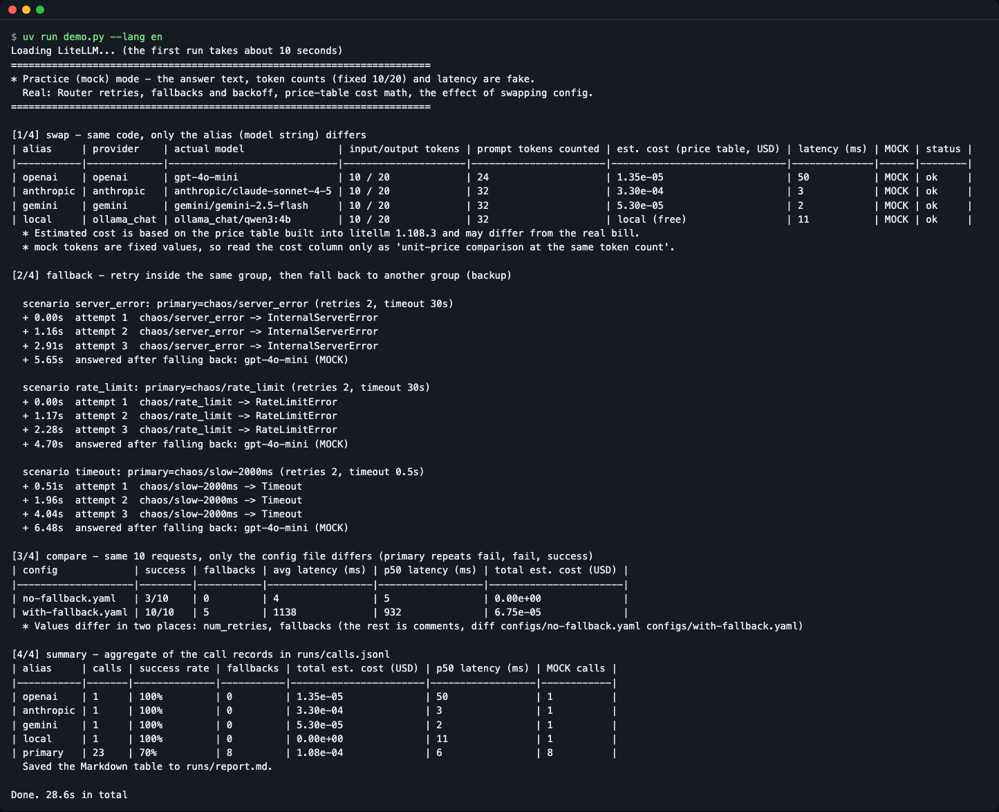
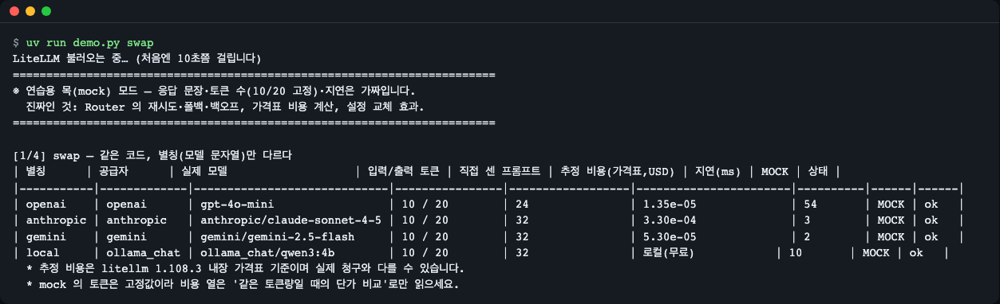
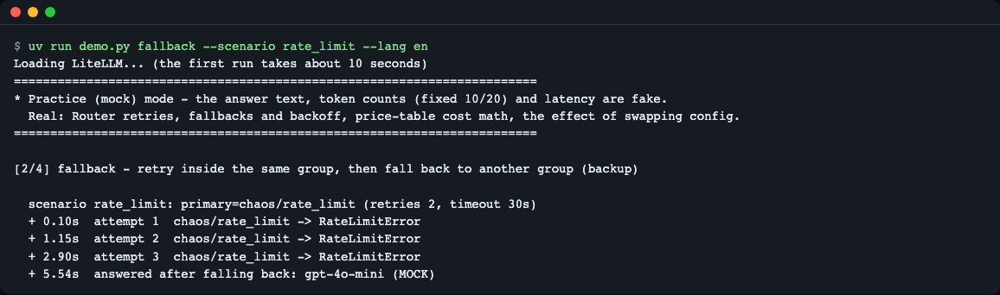
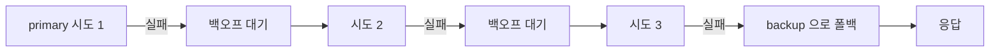
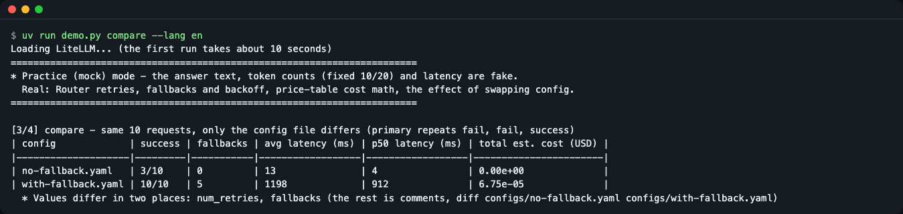
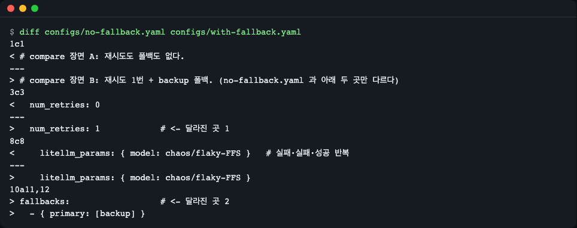
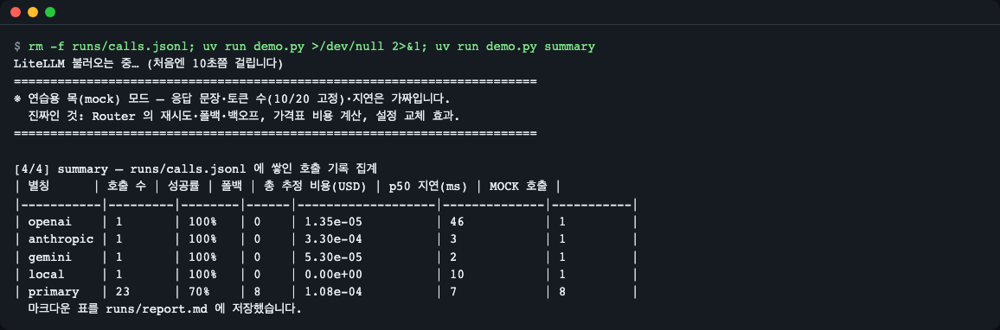
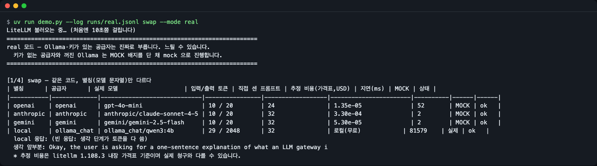
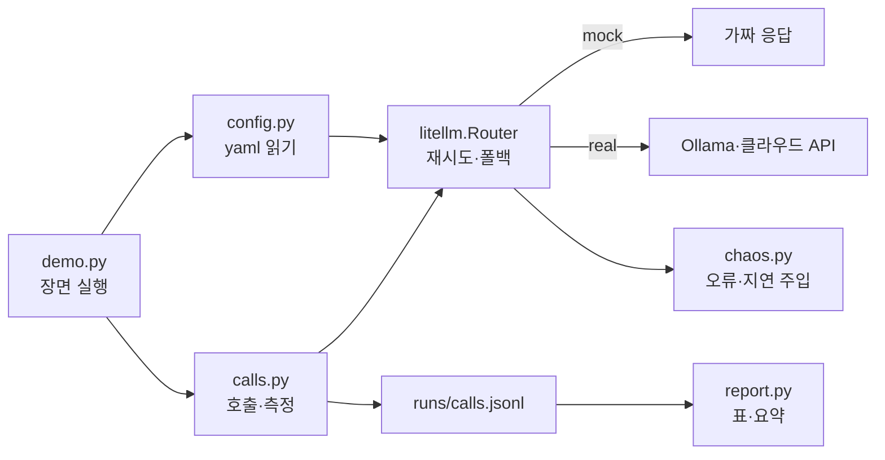

# LLM 게이트웨이 체험 — 모델 갈아 끼우기, 재시도, 폴백, 비용 기록

> **English summary** — A small CLI demo built on the LiteLLM SDK. It calls OpenAI-style, Anthropic, Gemini and local Ollama models through one function, shows how retries and fallbacks play out as a timeline, and logs tokens, estimated cost and latency per call.
> Run `uv run demo.py` to see everything. The default is a practice (mock) mode that needs no API key (the first install needs network access). Supports Python 3.11-3.14.


<sub>그림 1. `uv run demo.py` 한 번으로 swap, fallback, compare, summary 네 장면이 이어서 나온다.</sub>

## 한 줄 요약

설정 파일 하나(`configs/gateway.yaml`)로 여러 LLM 공급자를 같은 코드로 부르고, 한 모델이 실패하거나 느릴 때 "재시도, 그다음 폴백" 순서가 실제로 어떻게 도는지 타임라인으로 확인합니다.

**이런 분께:** LLM API를 한두 개 직접 불러 봤고, 여러 공급자를 묶거나 장애에 대비하는 방법이 궁금한 분.

## 왜 알아야 하나요?

택배를 보낼 때 한 회사만 쓰면, 그 회사가 파업하는 날 배송이 멈춥니다. 그래서 "A사로 보내 보고, 안 되면 B사로" 라는 규칙을 미리 정해 둡니다. 또 회사마다 요금이 달라서, 어디에 얼마를 썼는지 장부도 필요합니다.
LLM 게이트웨이가 이 역할을 합니다. 앱은 별칭 하나만 부르고, 게이트웨이가 실제 공급자를 고르고, 실패하면 다른 모델로 넘기고, 호출마다 토큰·비용·지연을 장부(`runs/calls.jsonl`)에 적습니다.

## 30초 만에 실행하기

준비물: Python 3.11~3.14 (레포는 3.12로 고정)와 [uv](https://docs.astral.sh/uv/). uv 설치: `curl -LsSf https://astral.sh/uv/install.sh | sh`. 최소 리눅스 환경에는 `git`과 `curl`도 필요합니다. API 키와 Ollama는 없어도 됩니다.

```bash
git clone https://github.com/LeeGyeongPil/ai-lab-llm-gateway.git
cd ai-lab-llm-gateway
uv run demo.py
```

처음에는 의존성 설치와 LiteLLM 불러오기 때문에 시간이 더 걸립니다. 설치 후 전체 실행은 작성 환경에서 약 28초였습니다.

> **연습용 목(mock) 모드입니다.** 응답 문장, 토큰 수(10/20 고정), 지연은 가짜입니다. 진짜인 것은 LiteLLM Router의 재시도·폴백·백오프 코드, 가격표를 곱한 비용 계산, 설정을 바꿨을 때의 효과입니다.

로컬 Ollama로 진짜 호출을 해 보는 방법은 아래 [real 모드 절](#real-모드-로컬-ollama와-내-키)에 따로 적었습니다.

## 단계별로 따라 하기

### 1단계. 같은 코드로 4개 모델 부르기

```bash
uv run demo.py swap
```


<sub>그림 2. 같은 질문을 별칭 4개로 보낸 결과.</sub>

실행 결과(발췌):

```text
| 별칭      | 공급자      | 실제 모델                   | 입력/출력 토큰 | 직접 센 프롬프트 | 추정 비용(가격표,USD) | ...
| openai    | openai      | gpt-4o-mini                 | 10 / 20        | 24               | 1.35e-05              | ...
| anthropic | anthropic   | anthropic/claude-sonnet-4-5 | 10 / 20        | 32               | 3.30e-04              | ...
| gemini    | gemini      | gemini/gemini-2.5-flash     | 10 / 20        | 32               | 5.30e-05              | ...
| local     | ollama_chat | ollama_chat/qwen3:4b        | 10 / 20        | 32               | 로컬(무료)            | ...
```

뜻: 바뀐 것은 모델 문자열의 접두사뿐이고 호출 코드는 같습니다. mock의 토큰이 모두 10/20이라서, 비용 차이(약 24배)는 "같은 토큰량일 때 단가 차이"로만 읽으세요. "직접 센 프롬프트" 열은 `litellm.token_counter`로 센 값입니다. 로컬 모델은 비용이 0이라 "로컬(무료)"로 표시합니다.

### 2단계. 실패했을 때 재시도와 폴백 보기

```bash
uv run demo.py fallback --scenario rate_limit
```


<sub>그림 3. 429 오류에서 같은 모델을 3번 시도한 뒤 backup으로 넘어간다.</sub>

실행 결과:

```text
  시나리오 rate_limit: primary=chaos/rate_limit (재시도 2회, timeout 30s)
  + 0.00s  시도 1  chaos/rate_limit -> RateLimitError
  + 0.57s  시도 2  chaos/rate_limit -> RateLimitError
  + 1.68s  시도 3  chaos/rate_limit -> RateLimitError
  + 4.10s  폴백으로 넘어가 응답: gpt-4o-mini (MOCK)
```

재시도와 폴백의 경계를 그림으로 보면 다음과 같습니다(`num_retries: 2`일 때).



뜻: "재시도"는 같은 모델에 다시 묻는 것이고(시도 사이 간격이 점점 늘어납니다), "폴백"은 재시도가 모두 실패한 뒤 다른 모델로 넘기는 것입니다. 시도 간격과 총 시간은 실행마다 조금씩 다릅니다. `--scenario server_error`(500 오류)와 `--scenario timeout`(응답이 제한 시간 0.5초를 넘김)도 해 보세요. 타임아웃은 기다린 시간이 그대로 사용자 대기 시간이 되어서 총 6~7초가 걸립니다.

### 3단계. 설정 파일만 바꿔 비교하기

```bash
uv run demo.py compare
```


<sub>그림 4. 같은 요청 10개, 설정만 다른 두 번의 실행.</sub>

```text
| 설정               | 성공  | 폴백 횟수 | 평균 지연(ms) | p50 지연(ms) | 총 추정 비용(USD) |
| no-fallback.yaml   | 3/10  | 0         | 6             | 6            | 0.00e+00          |
| with-fallback.yaml | 10/10 | 5         | 1157          | 1062         | 6.75e-05          |
```

뜻: 불안정한 primary(실패·실패·성공 반복)에서, 폴백이 없으면 3/10만 성공합니다. 폴백이 있으면 10/10이지만 평균 지연이 늘고 비용이 생깁니다. 안정성, 지연, 비용을 맞바꾸는 것입니다. 두 설정에서 값이 다른 곳은 `num_retries`와 `fallbacks` 두 곳이고, 나머지 차이는 주석뿐입니다.


<sub>그림 5. `diff configs/no-fallback.yaml configs/with-fallback.yaml`: 값이 달라진 곳은 `num_retries`와 `fallbacks`(1행·8행의 주석 차이도 함께 보입니다).</sub>

### 4단계. 호출 기록 집계 보기

```bash
uv run demo.py summary
```


<sub>그림 6. `runs/calls.jsonl`을 별칭별로 집계한 표.</sub>

```text
| 별칭      | 호출 수 | 성공률 | 폴백 | 총 추정 비용(USD) | p50 지연(ms) | MOCK 호출 |
| openai    | 1       | 100%   | 0    | 1.35e-05          | 71           | 1         |
| anthropic | 1       | 100%   | 0    | 3.30e-04          | 2            | 1         |
| gemini    | 1       | 100%   | 0    | 5.30e-05          | 1            | 1         |
| local     | 1       | 100%   | 0    | 0.00e+00          | 10           | 1         |
| primary   | 23      | 70%    | 8    | 1.08e-04          | 10           | 8         |
```

장부(`runs/calls.jsonl`)는 호출 한 번이 JSON 한 줄입니다. `head -1 runs/calls.jsonl` 로 첫 줄을 보면:

```json
{"ts": "2026-11-09T01:02:51+00:00", "scene": "swap", "alias": "openai", "provider": "openai", "model": "gpt-4o-mini", "prompt_tokens": 10, "completion_tokens": 20, "cost_usd": 1.35e-05, "latency_ms": 70.6, "status": "ok", "error_type": null, "fallback_used": false, "mock": true, "prompt_tokens_counted": 24}
```

| 필드 | 뜻 |
|---|---|
| `ts` | 기록 시각(UTC) |
| `scene` | 어느 장면에서 불렀는지(swap·fallback·compare·ask) |
| `alias` | 앱이 부른 별칭 |
| `provider` / `model` | 실제로 응답한 공급자와 모델 문자열 |
| `prompt_tokens` / `completion_tokens` | 응답 객체가 알려 준 입력/출력 토큰 수 |
| `cost_usd` | 가격표로 곱한 추정 비용. `null`이면 계산하지 않은 것(로컬 모델 등) |
| `latency_ms` | 호출 전후를 `perf_counter`로 잰 시간 |
| `status` / `error_type` | `ok` 또는 실패, 실패면 예외 이름 |
| `fallback_used` | 폴백을 거쳐 응답했는지 |
| `mock` | `true`면 연습용 가짜 응답(토큰 10/20은 가짜 값) |
| `prompt_tokens_counted` | `litellm.token_counter`로 직접 센 프롬프트 토큰 수 |

뜻: 모든 호출이 한 줄씩 장부에 쌓였고, 이 표는 장부를 모델 별칭별로 모은 것입니다. 같은 표가 `runs/report.md`에도 마크다운으로 저장됩니다. `summary`는 다른 장면이 만든 기록을 읽으므로 먼저 `uv run demo.py`를 한 번 실행하세요(위 표는 기록을 지우고 한 번 실행한 직후의 값입니다).

### 내 질문 던져 보기

```bash
uv run demo.py ask "LLM 게이트웨이를 한 줄로 설명해 줘" --model smart
```

```text
| smart | anthropic | anthropic/claude-sonnet-4-5 | 10 / 20 | 25 | 3.30e-04 | 47 | MOCK | ok |
응답: (연습용 목 응답) 게이트웨이는 여러 LLM 공급자를 한 가지 방식으로 부르게 해 주는 중간 계층입니다.
```

mock 모드의 응답 문장은 고정입니다. 이 호출도 장부에 기록됩니다.

## real 모드: 로컬 Ollama와 내 키

mock 모드는 연습용입니다. 진짜 호출은 두 가지로 해 볼 수 있습니다.

```bash
ollama pull qwen3:4b
uv run demo.py --log runs/real.jsonl swap --mode real
```

`--log`는 하위 명령(`swap`) 앞에 둡니다. 로컬 Ollama(기본 주소 `http://localhost:11434`)가 켜져 있으면 `local` 행만 진짜로 호출하고, 나머지 세 공급자는 키가 없으므로 MOCK 표시를 단 채 진행합니다. Ollama가 꺼져 있으면 안내 문구를 내고 mock으로 진행합니다(종료 코드 0).


<sub>그림 7. local 행의 MOCK 칸이 "실제"로 바뀐다. 이 그림은 생각이 길어져 2048 토큰을 다 쓴 실행이라 빈 응답 안내가 나왔다. 기본값 2048에서도 가끔 이런 일이 생긴다. 아래 발췌는 다른 실행(답이 나온 경우)의 값이다.</sub>

실행 결과(발췌, 작성 환경에서 한 번 실행한 값):

```text
| local     | ollama_chat | ollama_chat/qwen3:4b        | 29 / 778       | 32               | 로컬(무료)            | 27551    | 실제 | ok   |
  local 응답: LLM 게이트웨이란 사용자 애플리케이션과 대형 언어 모델(LLM) 간의 통신을 중개하여 ...
```

뜻: 토큰 수가 mock의 10/20 고정값이 아니라 모델이 알려 준 실제 값이고, 지연은 이번에는 약 28초였습니다(작성 환경 실측은 약 28초~1분 30초이고 생각 토큰 수에 따라 크게 달라집니다). 로컬 모델이라 비용은 0이어서 "로컬(무료)"입니다. 실제 모드는 내 컴퓨터를 쓰므로 느리고, 실행마다 답과 시간이 다릅니다.

- **qwen3의 생각 단계**: qwen3는 답하기 전에 "생각"하는 모델이라 출력 토큰을 생각에 먼저 씁니다. `configs/gateway.yaml`의 local `max_tokens`를 512처럼 낮추면 생각만 하다 끝나 "(빈 응답: 생각 단계가 토큰을 다 씀)"이 나옵니다. 그래서 기본값을 2048로 두었지만, 생각이 아주 길어지면 2048에서도 가끔 빈 응답이 나옵니다.
- **클라우드 공급자**: `.env.example`을 `.env`로 복사해 키를 넣으면 해당 공급자도 진짜로 부릅니다. 이때는 실제 요금이 청구될 수 있습니다.

## 어떻게 동작하나요?



- `demo.py`가 장면을 고르고, `config.py`가 yaml을 읽어 Router를 만듭니다.
- `calls.py`가 Router를 부르면서 걸린 시간을 재고, 토큰·비용·폴백 여부를 장부에 한 줄 적습니다.
- Router는 공급자 호출, 재시도, 폴백을 맡습니다. mock 모드에서는 가짜 응답을, real 모드에서는 진짜 서버를 부릅니다.
- `chaos.py`는 일부러 429·500·지연을 내는 가짜 공급자입니다. 던지는 예외는 진짜 LiteLLM 예외라서 Router의 재시도·폴백 코드는 실제로 돕니다.
- `report.py`가 장부를 읽어 표를 만듭니다.

이 데모는 앱 안에서 라이브러리로 쓰는 SDK 방식입니다. 같은 설정을 별도 서버로 띄우는 프록시 방식의 개념 예시는 [`docs/proxy-config.example.yaml`](docs/proxy-config.example.yaml)에 있습니다(실행하지 않습니다).

## 코드 둘러보기

| 파일 | 하는 일 |
|---|---|
| [`configs/gateway.yaml`](configs/gateway.yaml) | 별칭, 재시도 횟수, 폴백 규칙 |
| [`gateway/calls.py`](gateway/calls.py) | 호출 한 번과 기록 |
| [`gateway/chaos.py`](gateway/chaos.py) | 오류·지연 주입 |
| [`gateway/config.py`](gateway/config.py) | yaml로 Router 만들기, mock 주입 |
| [`gateway/report.py`](gateway/report.py) | 표와 집계 |

**1. 설정이 곧 라우팅** — `configs/gateway.yaml`:

```yaml
router_settings:
  num_retries: 2
model_list:
  - model_name: openai
    litellm_params: { model: gpt-4o-mini }
  - model_name: anthropic
    litellm_params: { model: anthropic/claude-sonnet-4-5 }
fallbacks:
  - { primary: [backup] }
```

앱은 `openai`나 `anthropic` 같은 별칭만 압니다. 모델을 바꿀 때 코드는 건드리지 않습니다.

**2. 호출 한 줄과 측정** — `gateway/calls.py`:

```python
resp = gw.router.completion(model=alias, messages=messages)
```

이 한 줄이 모든 공급자에 공통입니다. 지연은 앞뒤에서 `time.perf_counter()`로 재고, 토큰과 비용은 응답 객체에서 읽습니다.

**3. 오류를 일부러 만들기** — `gateway/chaos.py`: `chaos/rate_limit` 같은 모델 문자열을 부르면 LiteLLM의 사용자 지정 공급자(`CustomLLM`)가 진짜 `RateLimitError`를 던지고, 시도 때마다 기록을 남깁니다. 그래서 "Router가 몇 번 불렀는지"를 눈으로 셀 수 있습니다.

## 용어 사전

| 용어 | 뜻 |
|---|---|
| LLM 게이트웨이 | 여러 LLM 공급자 앞에 두는 중간 계층. 호출 형식 통일, 재시도, 폴백, 기록을 맡음 |
| [LiteLLM](https://github.com/BerriAI/litellm) | 여러 공급자를 OpenAI 형식 하나로 부르게 해 주는 오픈소스 라이브러리 |
| Router | LiteLLM에서 재시도·폴백·분산을 맡는 객체 |
| 별칭(model_name) | 앱이 부르는 이름. 실제 모델은 yaml에서 연결 |
| 재시도(retry) | 실패한 호출을 같은 모델에 다시 보내는 것 |
| 폴백(fallback) | 재시도까지 실패하면 다른 모델로 넘기는 것 |
| 429 / 5xx | 요청이 너무 많음 / 서버 내부 오류 |
| 타임아웃 | 정해진 시간 안에 응답이 없으면 실패로 처리 |
| 토큰 | 모델이 글자를 세는 단위. 비용은 토큰 수에 단가를 곱해 계산 |
| mock | 진짜 호출 대신 미리 정한 응답을 돌려주는 연습용 방식 |
| p50 | 지연을 크기순으로 세웠을 때 가운데 값(중앙값) |

## 직접 바꿔 보기

1. **재시도 횟수 바꾸기** — `configs/gateway.yaml`의 `num_retries: 2`를 `0`으로 → 폴백 타임라인에 시도가 1번만 나오고 총 시간이 줄어듭니다 → `uv run demo.py fallback --scenario rate_limit`
2. **다른 폴백 대상 지정** — `configs/gateway.yaml`의 `backup` 별칭이 가리키는 `model: gpt-4o-mini`를 `gemini/gemini-2.5-flash`로 → 폴백 뒤 응답 모델이 바뀝니다 → 같은 명령의 마지막 줄 모델명 확인
3. **실패 패턴 바꾸기** — `configs/no-fallback.yaml`의 `chaos/flaky-FFS`를 `chaos/flaky-FS`로 → 실패·성공 반복이라 성공이 늘어납니다 → `uv run demo.py compare`의 첫 줄 성공 칸 확인

(실험 결과는 설정 구조에서 예상한 값이며, 실행 후 표를 보고 맞는지 확인해 보세요.)

## 자주 겪는 문제

| 증상 | 원인 | 해결 |
|---|---|---|
| 처음 실행이 오래 걸림 | 의존성 설치와 LiteLLM 불러오기 | 한 번 설치되면 이후엔 짧아집니다. 전체 실행은 약 28초 |
| `summary`에 기록이 없다고 나옴 | `runs/calls.jsonl`이 아직 없음 | 먼저 `uv run demo.py` 실행 |
| real 모드에서 "Ollama에 연결할 수 없어 mock으로 진행합니다" | Ollama가 꺼져 있거나 주소가 다름 | `ollama serve`로 켜고, 주소가 다르면 `.env`의 `OLLAMA_API_BASE` 수정 |
| real 모드에서 local 응답이 "(빈 응답: 생각 단계가 토큰을 다 씀)" | qwen3가 답하기 전에 "생각"하며 `max_tokens`를 다 씀(기본 2048에서도 가끔, 낮추면 더 자주 발생) | `configs/gateway.yaml`의 local `max_tokens`를 4096 등으로 올리거나 다시 실행 |
| Python 3.10 이하에서 설치 실패 | `requires-python`이 3.11 이상 | `uv python install 3.12` 후 실행 |
| Python 3.15에서 설치 실패 | `requires-python`이 3.14까지 | `uv python install 3.12` 후 실행 |
| 비용이 실제 청구와 다름 | 패키지 내장 가격표(오프라인)로 계산한 추정값 | 참고용으로만 사용 |
| `--model nope` 처럼 없는 별칭을 넣으면 "별칭 nope 이 ... model_list 에 없습니다"가 나오고 종료 코드 2 | yaml에 없는 별칭 | 안내에 나온 사용 가능한 별칭 중에서 고르거나 yaml에 추가 |
| 모델 문자열을 `ollama/...`로 썼더니 응답이 이상함 | `ollama`와 `ollama_chat`은 다른 경로(채팅 형식은 `ollama_chat`) | `ollama_chat/모델명` 사용 |
| 의존성 버전을 마음대로 올리고 싶음 | `litellm`은 공급망 사고 이력이 있어 버전을 고정함 | `uv.lock`을 믿고, 올릴 땐 릴리스 노트를 확인 |

그 밖의 함정 두 가지입니다. 첫째, LiteLLM은 기본적으로 최신 가격표를 원격에서 받아 올 수 있는데, 이 데모는 `gateway/__init__.py`에서 `LITELLM_LOCAL_MODEL_COST_MAP=True`를 기본으로 설정해, 패키지에 든 가격표만 씁니다(오프라인에서도 같은 값이 나오고 시작이 느려지지 않습니다). 둘째, 토큰·비용은 콜백 대신 응답 객체에서 읽고 지연은 `perf_counter`로 앱에서 직접 잽니다. 폴백이 끼어도 "내가 부른 한 번의 총 시간"을 그대로 잴 수 있기 때문입니다.

테스트는 키·Ollama 없이 돕니다(작성 환경에서 11개 통과, 약 20~40초(환경에 따라 다름)).

```bash
uv run pytest -q
```

## 더 알아보기

확인일 2026-11-09. 이 데모는 litellm 1.108.3 기준입니다.

- [LiteLLM 라우팅(Router)](https://docs.litellm.ai/docs/routing)
- [LiteLLM 폴백·재시도 순서](https://docs.litellm.ai/docs/proxy/reliability)
- [LiteLLM mock_response](https://docs.litellm.ai/docs/completion/mock_requests)
- [LiteLLM 비용 불일치 문제 해결](https://docs.litellm.ai/docs/troubleshoot/cost_discrepancy)
- [LiteLLM 공급망 사고 공지](https://docs.litellm.ai/blog/security-update-march-2026)
- [LiteLLM GitHub](https://github.com/BerriAI/litellm)

비슷한 도구(확인일 2026-11-09):

- [any-llm](https://github.com/mozilla-ai/any-llm) — Python SDK. 공급자 교체(형식 통일)에 집중하고 폴백·라우팅은 문서상 없음.
- [Portkey Gateway](https://github.com/Portkey-AI/gateway) — Node 서버형. 폴백·재시도·부하 분산을 제공.
- Bifrost(Maxim AI, Go 서버형) — 성능 지향 게이트웨이. 입문용으로는 과해서 다루지 않았습니다. 출처: [대안 비교 글(벤더 글, 참고만)](https://www.getmaxim.ai/articles/top-litellm-alternatives-in-2026/)

## 변경 이력

- 0.1.3 (2026-11-10): 변경 이력에 빠졌던 0.1.2 항목 추가.
- 0.1.2 (2026-11-09): compare 장면 문구를 표와 맞게 수정, 스크린샷 다시 찍기, 실제 모드 설명을 측정값에 맞춤, CI 잡 타임아웃 추가와 폴백 테스트 타이밍 단언 완화.
- 0.1.1 (2026-11-09): 전이 의존성 filelock 4.2.9 로 보안 업데이트, Python 3.11 이상 필요 (이전에는 3.10도 지원).
- 0.1.0: 첫 공개.

## 라이선스

MIT — [LICENSE](LICENSE). 사용한 LiteLLM은 별도 라이선스를 따릅니다([레포](https://github.com/BerriAI/litellm) 참고).
