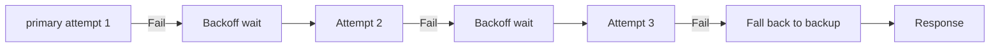
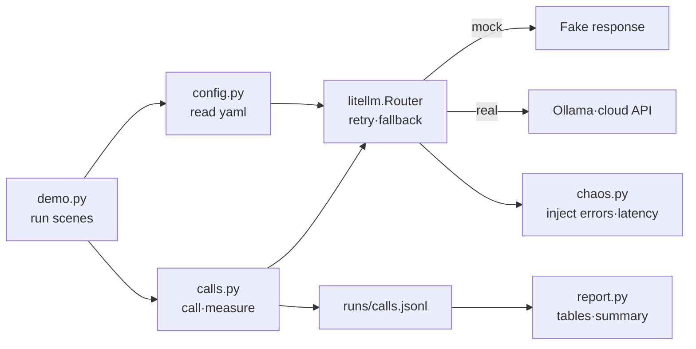

# Trying an LLM Gateway — Swapping Models, Retries, Fallbacks and Cost Logging

**English** | [한국어](README.ko.md)

A small CLI demo built on the LiteLLM SDK. It calls OpenAI-style, Anthropic, Gemini and local Ollama models through one function, shows how retries and fallbacks play out as a timeline, and logs tokens, estimated cost and latency per call. Run `uv run demo.py` to see everything. The default is a practice (mock) mode that needs no API key (the first install needs network access). Supports Python 3.11-3.14.


<sub>Figure 1. A single `uv run demo.py` prints the four scenes in a row: swap, fallback, compare and summary.</sub>

## One-line summary

With one config file (`configs/gateway.yaml`), you call several LLM providers with the same code, and see on a timeline how the "retry, then fallback" order actually plays out when a model fails or is slow.

**Who this is for:** People who have called one or two LLM APIs directly and are curious how to combine several providers or prepare for outages.

## Why should you care?

If you ship parcels with only one courier, deliveries stop the day that company goes on strike. So you set a rule in advance: "try company A, and if that fails, company B." Prices also differ by company, so you need a ledger of how much was spent where.
An LLM gateway plays this role. The app calls just one alias, and the gateway picks the actual provider, hands over to another model on failure, and writes tokens, cost and latency for every call into a ledger (`runs/calls.jsonl`).

## Run it in 30 seconds

You need Python 3.11–3.14 (the repo is pinned to 3.12) and [uv](https://docs.astral.sh/uv/). Install uv with `curl -LsSf https://astral.sh/uv/install.sh | sh`. A minimal Linux environment also needs `git` and `curl`. You don't need an API key or Ollama.

```bash
git clone https://github.com/LeeGyeongPil/ai-lab-llm-gateway.git
cd ai-lab-llm-gateway
uv run demo.py
```

The first run takes longer because of dependency installation and importing LiteLLM. After installation, a full run took about 28 seconds in the authoring environment.

> **This is the practice mock mode.** The answer sentences, token counts (fixed at 10/20) and latencies are fake. What is real is LiteLLM Router's retry, fallback and backoff code, the cost calculation that multiplies by a price table, and the effect of changing the config.

How to make real calls with a local Ollama is described separately below in the [real mode section](#real-mode-local-ollama-and-your-own-key).

## Step by step

### Step 1. Call 4 models with the same code

```bash
uv run demo.py swap
```


<sub>Figure 2. The result of sending the same question through 4 aliases.</sub>

Output (excerpt):

```text
| 별칭      | 공급자      | 실제 모델                   | 입력/출력 토큰 | 직접 센 프롬프트 | 추정 비용(가격표,USD) | ...
| openai    | openai      | gpt-4o-mini                 | 10 / 20        | 24               | 1.35e-05              | ...
| anthropic | anthropic   | anthropic/claude-sonnet-4-5 | 10 / 20        | 32               | 3.30e-04              | ...
| gemini    | gemini      | gemini/gemini-2.5-flash     | 10 / 20        | 32               | 5.30e-05              | ...
| local     | ollama_chat | ollama_chat/qwen3:4b        | 10 / 20        | 32               | 로컬(무료)            | ...
```

(Column headers: alias, provider, actual model, input/output tokens, prompt tokens counted directly, estimated cost (price table, USD). "로컬(무료)" means "local (free)".)

What it means: only the prefix of the model string changed, and the calling code is the same. Because the mock tokens are all 10/20, read the cost difference (about 24x) only as "the difference in unit price at the same token count." The "prompt tokens counted directly" column is the value counted with `litellm.token_counter`. A local model costs 0, so it is shown as "로컬(무료)".

### Step 2. See retries and fallback on failure

```bash
uv run demo.py fallback --scenario rate_limit
```


<sub>Figure 3. On a 429 error, the same model is tried 3 times and then it moves to backup.</sub>

Output:

```text
  시나리오 rate_limit: primary=chaos/rate_limit (재시도 2회, timeout 30s)
  + 0.00s  시도 1  chaos/rate_limit -> RateLimitError
  + 0.57s  시도 2  chaos/rate_limit -> RateLimitError
  + 1.68s  시도 3  chaos/rate_limit -> RateLimitError
  + 4.10s  폴백으로 넘어가 응답: gpt-4o-mini (MOCK)
```

(Scenario rate_limit: primary=chaos/rate_limit (2 retries, timeout 30s); attempt 1, 2, 3; "폴백으로 넘어가 응답" means "moved to fallback and answered".)

The boundary between retry and fallback looks like this (with `num_retries: 2`).



What it means: a "retry" asks the same model again (the gap between attempts grows), and a "fallback" hands over to another model after all retries have failed. The gaps between attempts and the total time differ slightly from run to run. Also try `--scenario server_error` (a 500 error) and `--scenario timeout` (the response exceeds the 0.5-second limit). With a timeout, the time spent waiting becomes the user's waiting time as is, so it takes 6–7 seconds in total.

### Step 3. Compare by changing only the config file

```bash
uv run demo.py compare
```


<sub>Figure 4. The same 10 requests, two runs that differ only in the config.</sub>

```text
| 설정               | 성공  | 폴백 횟수 | 평균 지연(ms) | p50 지연(ms) | 총 추정 비용(USD) |
| no-fallback.yaml   | 3/10  | 0         | 6             | 6            | 0.00e+00          |
| with-fallback.yaml | 10/10 | 5         | 1157          | 1062         | 6.75e-05          |
```

(Columns: config, success, fallback count, mean latency (ms), p50 latency (ms), total estimated cost (USD).)

What it means: with an unstable primary (fail, fail, succeed, repeating), only 3/10 succeed without fallback. With fallback it is 10/10, but the mean latency grows and cost appears. You are trading off stability, latency and cost. The values that differ between the two configs are two places, `num_retries` and `fallbacks`, and the other differences are only comments.


<sub>Figure 5. `diff configs/no-fallback.yaml configs/with-fallback.yaml`: the values that differ are `num_retries` and `fallbacks` (the comment differences on lines 1 and 8 are shown too).</sub>

### Step 4. See the aggregated call log

```bash
uv run demo.py summary
```


<sub>Figure 6. A table aggregating `runs/calls.jsonl` by alias.</sub>

```text
| 별칭      | 호출 수 | 성공률 | 폴백 | 총 추정 비용(USD) | p50 지연(ms) | MOCK 호출 |
| openai    | 1       | 100%   | 0    | 1.35e-05          | 71           | 1         |
| anthropic | 1       | 100%   | 0    | 3.30e-04          | 2            | 1         |
| gemini    | 1       | 100%   | 0    | 5.30e-05          | 1            | 1         |
| local     | 1       | 100%   | 0    | 0.00e+00          | 10           | 1         |
| primary   | 23      | 70%    | 8    | 1.08e-04          | 10           | 8         |
```

(Columns: alias, number of calls, success rate, fallbacks, total estimated cost (USD), p50 latency (ms), MOCK calls.)

In the ledger (`runs/calls.jsonl`), one call is one JSON line. Looking at the first line with `head -1 runs/calls.jsonl`:

```json
{"ts": "2026-11-09T01:02:51+00:00", "scene": "swap", "alias": "openai", "provider": "openai", "model": "gpt-4o-mini", "prompt_tokens": 10, "completion_tokens": 20, "cost_usd": 1.35e-05, "latency_ms": 70.6, "status": "ok", "error_type": null, "fallback_used": false, "mock": true, "prompt_tokens_counted": 24}
```

| Field | Meaning |
|---|---|
| `ts` | Time recorded (UTC) |
| `scene` | Which scene made the call (swap · fallback · compare · ask) |
| `alias` | The alias the app called |
| `provider` / `model` | The provider and model string that actually responded |
| `prompt_tokens` / `completion_tokens` | Input/output token counts reported by the response object |
| `cost_usd` | Estimated cost multiplied by the price table. `null` means it was not computed (local models, etc.) |
| `latency_ms` | Time measured around the call with `perf_counter` |
| `status` / `error_type` | `ok` or failure; on failure, the exception name |
| `fallback_used` | Whether the response came through a fallback |
| `mock` | If `true`, a fake practice response (the 10/20 tokens are fake values) |
| `prompt_tokens_counted` | Prompt token count counted directly with `litellm.token_counter` |

What it means: every call piled up as one line in the ledger, and this table groups the ledger by model alias. The same table is also saved as Markdown in `runs/report.md`. `summary` reads records made by the other scenes, so run `uv run demo.py` once first (the table above is the value right after clearing the records and running once).

### Ask your own question

```bash
uv run demo.py ask "LLM 게이트웨이를 한 줄로 설명해 줘" --model smart
```

```text
| smart | anthropic | anthropic/claude-sonnet-4-5 | 10 / 20 | 25 | 3.30e-04 | 47 | MOCK | ok |
응답: (연습용 목 응답) 게이트웨이는 여러 LLM 공급자를 한 가지 방식으로 부르게 해 주는 중간 계층입니다.
```

(The question means "Explain an LLM gateway in one line." The response reads "(practice mock response) A gateway is an intermediate layer that lets you call several LLM providers in one way.")

The answer sentence in mock mode is fixed. This call is also recorded in the ledger.

## Real mode: local Ollama and your own key

Mock mode is for practice. You can make real calls in two ways.

```bash
ollama pull qwen3:4b
uv run demo.py --log runs/real.jsonl swap --mode real
```

Put `--log` before the subcommand (`swap`). If a local Ollama (default address `http://localhost:11434`) is running, only the `local` row is called for real, and the other three providers carry on with a MOCK mark because there are no keys. If Ollama is off, it prints a notice and carries on with mock (exit code 0).


<sub>Figure 7. The MOCK cell of the local row changes to "실제" ("real"). This figure is a run where thinking got long and used up all 2048 tokens, so an empty-response notice appeared. This sometimes happens even with the default 2048. The excerpt below is from another run (where an answer came out).</sub>

Output (excerpt, a value from one run in the authoring environment):

```text
| local     | ollama_chat | ollama_chat/qwen3:4b        | 29 / 778       | 32               | 로컬(무료)            | 27551    | 실제 | ok   |
  local 응답: LLM 게이트웨이란 사용자 애플리케이션과 대형 언어 모델(LLM) 간의 통신을 중개하여 ...
```

(The answer reads "An LLM gateway mediates communication between a user application and a large language model (LLM) ...".)

What it means: the token counts are the real values reported by the model, not the fixed 10/20 of mock, and the latency this time was about 28 seconds (measured in the authoring environment, it is about 28 seconds to 1 minute 30 seconds and varies a lot with the number of thinking tokens). It is a local model, so the cost is 0 and shown as "로컬(무료)". Real mode uses your own computer, so it is slow, and the answer and time differ on every run.

- **qwen3's thinking stage**: qwen3 is a model that "thinks" before answering, so it spends output tokens on thinking first. If you lower the local `max_tokens` in `configs/gateway.yaml` to something like 512, it ends up only thinking and prints "(빈 응답: 생각 단계가 토큰을 다 씀)" ("(empty response: the thinking stage used up all the tokens)"). That is why the default is 2048, but if thinking gets very long, an empty response sometimes appears even with 2048.
- **Cloud providers**: copy `.env.example` to `.env` and put in your keys, and those providers are also called for real. Real charges may be incurred in that case.

## How does it work?



- `demo.py` picks the scene, and `config.py` reads the yaml and builds the Router.
- `calls.py` calls the Router, measures the time taken, and writes one line to the ledger with tokens, cost and whether a fallback occurred.
- The Router handles provider calls, retries and fallbacks. In mock mode it returns fake responses; in real mode it calls the real servers.
- `chaos.py` is a fake provider that deliberately produces 429s, 500s and delays. The exceptions it throws are real LiteLLM exceptions, so the Router's retry and fallback code actually runs.
- `report.py` reads the ledger and builds the tables.

This demo is the SDK approach, used as a library inside the app. A conceptual example of the proxy approach, which runs the same config as a separate server, is in [`docs/proxy-config.example.yaml`](docs/proxy-config.example.yaml) (it is not executed).

## Code tour

| File | What it does |
|---|---|
| [`configs/gateway.yaml`](configs/gateway.yaml) | Aliases, retry count, fallback rules |
| [`gateway/calls.py`](gateway/calls.py) | One call and its record |
| [`gateway/chaos.py`](gateway/chaos.py) | Error and latency injection |
| [`gateway/config.py`](gateway/config.py) | Building the Router from yaml, mock injection |
| [`gateway/report.py`](gateway/report.py) | Tables and aggregation |

**1. The config is the routing** — `configs/gateway.yaml`:

```yaml
router_settings:
  num_retries: 2
model_list:
  - model_name: openai
    litellm_params: { model: gpt-4o-mini }
  - model_name: anthropic
    litellm_params: { model: anthropic/claude-sonnet-4-5 }
fallbacks:
  - { primary: [backup] }
```

The app knows only aliases such as `openai` and `anthropic`. When you change models, you don't touch the code.

**2. One call line and measurement** — `gateway/calls.py`:

```python
resp = gw.router.completion(model=alias, messages=messages)
```

This one line is common to all providers. Latency is measured before and after with `time.perf_counter()`, and tokens and cost are read from the response object.

**3. Creating errors on purpose** — `gateway/chaos.py`: when you call a model string like `chaos/rate_limit`, LiteLLM's custom provider (`CustomLLM`) throws a real `RateLimitError` and leaves a record on every attempt. That is why you can count "how many times the Router called" by eye.

## Glossary

| Term | Meaning |
|---|---|
| LLM gateway | An intermediate layer placed in front of several LLM providers. Handles unifying the call format, retries, fallbacks and logging |
| [LiteLLM](https://github.com/BerriAI/litellm) | An open-source library that lets you call several providers in one OpenAI format |
| Router | The object in LiteLLM that handles retries, fallbacks and distribution |
| Alias (model_name) | The name the app calls. The actual model is linked in the yaml |
| Retry | Sending a failed call to the same model again |
| Fallback | Handing over to another model when even retries fail |
| 429 / 5xx | Too many requests / server internal error |
| Timeout | Treating it as a failure if there is no response within a set time |
| Token | The unit in which a model counts text. Cost is computed by multiplying the token count by the unit price |
| mock | A practice mode that returns predefined responses instead of making real calls |
| p50 | The middle value (median) when latencies are lined up by size |

## Try changing things yourself

1. **Change the retry count** — change `num_retries: 2` in `configs/gateway.yaml` to `0` → the fallback timeline shows only 1 attempt and the total time shrinks → `uv run demo.py fallback --scenario rate_limit`
2. **Pick a different fallback target** — change `model: gpt-4o-mini`, which the `backup` alias in `configs/gateway.yaml` points to, to `gemini/gemini-2.5-flash` → the model that responds after the fallback changes → check the model name on the last line of the same command
3. **Change the failure pattern** — change `chaos/flaky-FFS` in `configs/no-fallback.yaml` to `chaos/flaky-FS` → it alternates failure and success, so successes increase → check the success cell on the first line of `uv run demo.py compare`

(The experiment results are values expected from the config structure; after running, check the table to see whether they hold.)

## Troubleshooting

| Symptom | Cause | Fix |
|---|---|---|
| The first run takes long | Dependency installation and importing LiteLLM | Once installed it gets shorter. A full run takes about 28 seconds |
| `summary` says there are no records | `runs/calls.jsonl` doesn't exist yet | Run `uv run demo.py` first |
| In real mode, "Ollama에 연결할 수 없어 mock으로 진행합니다" ("cannot connect to Ollama, continuing with mock") | Ollama is off or the address differs | Start it with `ollama serve`, and if the address differs, edit `OLLAMA_API_BASE` in `.env` |
| In real mode, the local answer is "(빈 응답: 생각 단계가 토큰을 다 씀)" ("(empty response: the thinking stage used up all the tokens)") | qwen3 "thinks" before answering and uses up `max_tokens` (sometimes even with the default 2048, more often if lowered) | Raise the local `max_tokens` in `configs/gateway.yaml` to something like 4096, or run again |
| Install fails on Python 3.10 or lower | `requires-python` is 3.11 or higher | Run after `uv python install 3.12` |
| Install fails on Python 3.15 | `requires-python` goes up to 3.14 | Run after `uv python install 3.12` |
| Cost differs from the actual bill | It is an estimate computed with the price table built into the package (offline) | Use it for reference only |
| Passing a nonexistent alias such as `--model nope` prints "별칭 nope 이 ... model_list 에 없습니다" ("alias nope is not in ... model_list") and exit code 2 | An alias that is not in the yaml | Pick from the available aliases listed in the message, or add it to the yaml |
| I wrote the model string as `ollama/...` and the response is odd | `ollama` and `ollama_chat` are different paths (use `ollama_chat` for the chat format) | Use `ollama_chat/model-name` |
| I want to bump dependency versions freely | `litellm` has a supply-chain incident history, so the version is pinned | Trust `uv.lock`, and check the release notes when you upgrade |

Two other pitfalls. First, LiteLLM can by default fetch the latest price table remotely, but this demo sets `LITELLM_LOCAL_MODEL_COST_MAP=True` by default in `gateway/__init__.py`, so it uses only the price table bundled in the package (you get the same values offline and startup doesn't slow down). Second, tokens and cost are read from the response object instead of a callback, and latency is measured directly in the app with `perf_counter`. That is because even when a fallback intervenes, you can measure "the total time of the one call I made" as is.

The tests run without keys or Ollama (11 passed in the authoring environment, about 20–40 seconds (varies by environment)).

```bash
uv run pytest -q
```

## Further reading

Checked on 2026-11-09. This demo is based on litellm 1.108.3.

- [LiteLLM routing (Router)](https://docs.litellm.ai/docs/routing)
- [LiteLLM fallback and retry order](https://docs.litellm.ai/docs/proxy/reliability)
- [LiteLLM mock_response](https://docs.litellm.ai/docs/completion/mock_requests)
- [Troubleshooting LiteLLM cost discrepancies](https://docs.litellm.ai/docs/troubleshoot/cost_discrepancy)
- [LiteLLM supply-chain incident notice](https://docs.litellm.ai/blog/security-update-march-2026)
- [LiteLLM GitHub](https://github.com/BerriAI/litellm)

Similar tools (checked on 2026-11-09):

- [any-llm](https://github.com/mozilla-ai/any-llm) — A Python SDK. Focuses on swapping providers (unifying the format), and per its docs has no fallback or routing.
- [Portkey Gateway](https://github.com/Portkey-AI/gateway) — A Node server type. Provides fallbacks, retries and load balancing.
- Bifrost (Maxim AI, Go server type) — A performance-oriented gateway. Too much for an introduction, so it is not covered. Source: [an alternatives comparison article (a vendor article, for reference only)](https://www.getmaxim.ai/articles/top-litellm-alternatives-in-2026/)

## Changelog

- 0.1.3 (2026-11-10): Added the 0.1.2 entry that was missing from the changelog.
- 0.1.2 (2026-11-09): Fixed the compare scene wording to match the table, retook screenshots, aligned the real-mode explanation with measured values, added a CI job timeout and relaxed the timing assertion in the fallback test.
- 0.1.1 (2026-11-09): Security update of the transitive dependency filelock to 4.2.9; Python 3.11 or later required (previously 3.10 was also supported).
- 0.1.0: First release.

## License

MIT — [LICENSE](LICENSE). The LiteLLM used follows its own license (see its [repo](https://github.com/BerriAI/litellm)).
